<div align="center">



<br/>

<a href="https://dyskolos.fr"></a>
<a href="https://www.linkedin.com/in/baptiste-beuille"></a>
<a href="mailto:contact@dyskolos.fr"></a>

</div>

<br/>

## ◆ running services

| unit | state | what it does |
|:--|:--|:--|
| [**orphyn**](https://github.com/Dyskolos-Dev/Orphyn) |  | Jellyfin client for Windows, macOS and Linux. Player, music, synced lyrics, casting. Rust. [Website](https://orphyn.dyskolos.fr) |
| [**webdash**](https://github.com/Dyskolos-Dev/WebDash) |  | Self-hosted tech dashboard: real-time monitoring, 19+ extensions, public status page. TypeScript, React, Docker. |
| [**prism**](https://github.com/Dyskolos-Dev/forum-prism) |  | Astronomy and space forum, team project at Ynov. Go backend, SQLite, framework-free front end. |
| [**podsdesk**](https://github.com/Dyskolos-Dev/PodsDesk) |  | AirPods companion for Windows: Bluetooth battery levels, alerts, light/dark themes, 5 languages. C#. |

<br/>

## ◆ the stack, from cable to interface

```text
┌─ interface ──────┐  Orphyn · WebDash · Prism · PodsDesk
├─ applications ───┤  Rust · Go · TypeScript · C# · Java · Luau
├─ services ───────┤  Active Directory · Docker · Home Assistant · Jellyfin
├─ virtualization ─┤  Proxmox · VMware
├─ systems ────────┤  Windows Server · Debian · Ubuntu
└─ network ────────┘  DNS · DHCP · VPN · firewall
```

<br/>

## ◆ log

<div align="center">


</div>

<!--START_SECTION:activity-->
<!--END_SECTION:activity-->

<br/>

## ◆ get in touch

I'm looking for an **internship in systems & network administration**, and a work-study placement afterwards.
An idea, a project, a question: [contact@dyskolos.fr](mailto:contact@dyskolos.fr) or [dyskolos.fr](https://dyskolos.fr).

<div align="center">
<sub><tt>dyskolos@horme:~$ _</tt></sub>
</div>
