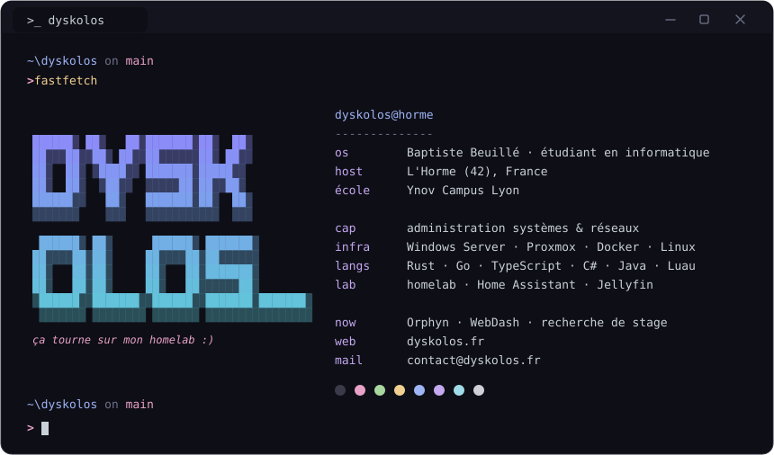
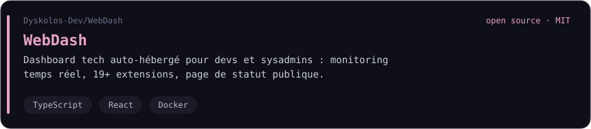
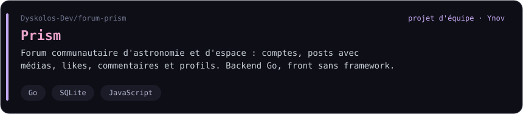
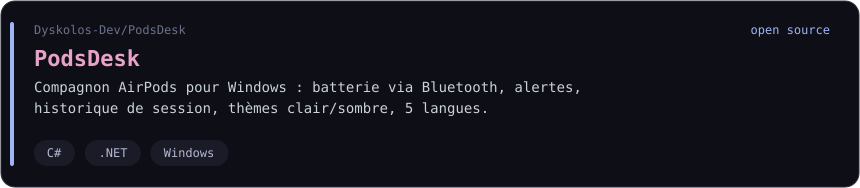
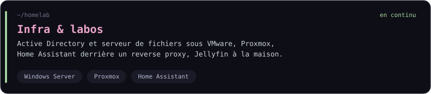
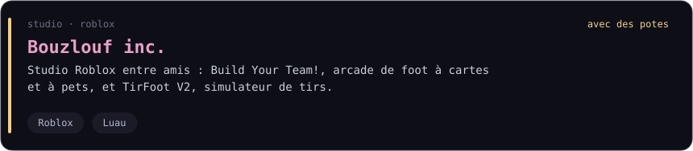

<h3>
je prépare mon avenir dans l'<b>administration systèmes & réseaux</b>, 
je code <b>Orphyn</b>, un client Jellyfin pour desktop, 
et je garde un homelab qui ne dort jamais.
</h3>

&nbsp;
&nbsp;

 

<h3><tt>❯ ./orphyn</tt></h3>

<h3>Un client Jellyfin pour Windows, macOS et Linux.</h3>

lecteur intégré · musique et paroles synchronisées · casting · mises à jour automatiques

&nbsp;
&nbsp;
&nbsp;

&nbsp;
&nbsp;

 

<h3><tt>❯ ls ~/projets</tt></h3>

 

<h3><tt>❯ ls ~/ailleurs</tt></h3>

 

<h3><tt>❯ cat stack.toml</tt></h3>

<table>
<tr>
<td><tt>[ langages ]</tt></td>
<td>

</td>
</tr>
<tr>
<td><tt>[ web ]</tt></td>
<td>

</td>
</tr>
<tr>
<td><tt>[ systèmes ]</tt></td>
<td>

</td>
</tr>
<tr>
<td><tt>[ maison ]</tt></td>
<td>

</td>
</tr>
</table>

 

<h3><tt>❯ gh stats</tt></h3>

 

<h3><tt>❯ git log --oneline</tt></h3>

<!--START_SECTION:activity-->
<!--END_SECTION:activity-->

 

<tt>❯ exit</tt>

